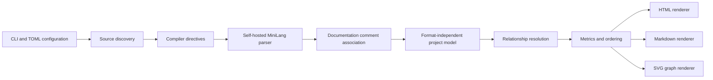

# MiniDoc

[](LICENSE)
[](src/main.ml)

MiniDoc is a documentation generator for MiniLang projects, written entirely in MiniLang. It reads the same project structure and source syntax as the self-hosted MiniLang compiler and produces either an offline HTML documentation site, a linked Markdown documentation tree, or both.

> Project status: working preview (`0.4.3`). The end-to-end generator, HTML and Markdown renderers, source metrics, dependency views, scalable graphs, configuration loader, and MiniLang test suite are implemented. See [Current limitations](#current-limitations) before treating the output as a complete semantic API reference.

The repository dogfoods MiniDoc. Browse the committed [GitHub-friendly API documentation](docs/api/markdown/README.md), or download the repository and open [the offline HTML start page](docs/api/html/index.html). Both trees are regenerated from the documented MiniDoc source with [`minidoc.toml`](minidoc.toml).

## Highlights

- Uses the self-hosted MiniLang compiler frontend instead of maintaining a second grammar.
- Reads an entry file, a `minilang.toml` project, or a dedicated `minidoc.toml` file.
- Follows imports and can also discover non-reachable `.ml` source files below configured roots.
- Understands compile-time definitions and the selected MiniLang target.
- Documents packages, namespaces, functions, nested functions, parameters, structs, fields, methods, user-defined operators and overloads, interfaces, enums, constants, globals, and extern functions.
- Preserves signatures, parameter types, optional markers, defaults, variadic parameters, return types, and function modifiers.
- Generates an offline HTML site with navigation and client-side symbol search.
- Generates a project-specific introduction, an at-a-glance metrics dashboard, and responsive navigation cards on the home page.
- Adds the MiniDoc version, an optional reproducible generation timestamp, and the source revision to generated metadata.
- Keeps long package and navigation card labels inside responsive card boundaries.
- Generates GitHub-compatible repository Markdown or a GitHub Wiki tree with `Home.md` and `_Sidebar.md`.
- Emits deduplicated package-level SVG import, call, and interface-implementation graphs without Graphviz, with optional symbol-level detail.
- Calculates LOC, cyclomatic and cognitive complexity, duplicate code, Halstead metrics, maintainability, and category-specific documentation coverage.
- Keeps imported libraries compact by default: dependency source files are summarized without expanding their complete APIs.
- Produces stable page names, anchors, case-insensitive alphabetical ordering, and output manifests for reproducible builds.
- Escapes generated HTML and ships with a restrictive Content Security Policy.
- Warns about missing license headers, incomplete parameter and return contracts, generic summaries, and excessively reused documentation text.

## Quick start

### Prebuilt releases

GitHub releases provide separate archives for Windows x64 and Linux x64. Each archive contains the MiniDoc executable, this README, and the Apache 2.0 license. Extract the archive and run `minidoc.exe --help` on Windows or `./minidoc --help` on Linux.

### Prerequisites

MiniDoc currently builds against the self-hosted [MiniLang compiler](https://github.com/MiniLangProject/MiniLangCompilerML). The default build scripts expect sibling checkouts:

```text
workspace/
├── MiniDoc/
└── MiniLangCompilerML/
```

On Windows, a compiler at another location can be selected with `-Compiler`. On Linux, set `MINILANG_COMPILER`; the compiler source checkout must still be available as an import root beside MiniDoc.

### Windows

From the repository root:

```powershell
.\build.ps1
```

The script builds `build/minidoc.exe`, builds the MiniLang test executable, and runs the complete test suite.

To compile without running tests:

```powershell
.\build.ps1 -SkipTests
```

To use a compiler at another location:

```powershell
.\build.ps1 -Compiler C:\path\to\mlc_win64.exe
```

### Linux

```bash
./build.sh
```

Set `MINILANG_COMPILER` when the compiler is not available at `../MiniLangCompilerML/build/mlc_linux_x64` relative to MiniDoc.

### Generate documentation

For one entry file:

```powershell
.\build\minidoc.exe .\src\main.ml
```

For a MiniLang project manifest:

```powershell
.\build\minidoc.exe --project .\minilang.toml
```

For a dedicated MiniDoc configuration:

```powershell
.\build\minidoc.exe --config .\minidoc.toml
```

By default, MiniDoc writes HTML to `build/minidoc/html` and Markdown to `build/minidoc/markdown`. Relative paths in a project or MiniDoc configuration are resolved from the directory containing that file. Relative command-line output paths are resolved from the current working directory.

## Documentation comments

MiniDoc recognizes declaration comments and file comments. `///` is the preferred explicit declaration form; a normal `//` block immediately preceding a declaration is also accepted for compatibility with established MiniLang projects.

```ml
//! Public services exposed by this source file.

package example.services

/// Loads a user by identifier.
///
/// The cache is checked before persistent storage.
/// @param id The stable user identifier.
/// @returns The matching user.
/// @error NOT_FOUND No user has this identifier.
/// @see example.models.User
/// @since 1.2.0
function loadUser(id as int) returns User
  // ...
end function
```

The block forms `/** ... */` and `/*! ... */` are supported as declaration and file documentation respectively. A normal `/* ... */` block directly before a declaration is accepted as well. A declaration comment must be separated from its declaration only by whitespace.

Supported structured tags are:

| Tag | Purpose |
| --- | --- |
| `@param name text` | Documents a named parameter. |
| `@returns text` | Documents the return value. |
| `@error name text` | Documents an error contract. |
| `@deprecated text` | Marks an API as deprecated. |
| `@see target text` | Adds a related-symbol reference. |
| `@since version` | Records the first project version containing the API. |
| `@example text` | Adds example content. Continuation lines belong to the tag. |
| `@group name` | Records a logical documentation group for future presentation. |
| `@testmethod [name]` | Marks a synchronous zero-parameter procedure as a test and optionally gives it a display name. |
| `@beforeall`, `@afterall` | Mark suite-level setup and teardown procedures. |
| `@beforeeach`, `@aftereach` | Mark per-test setup and teardown procedures. |
| `@category name` | Adds a test category. The tag may be repeated. |
| `@covers symbol` | Records the API or behavior covered by a test. The tag may be repeated. |
| `@timeout milliseconds` | Sets a positive per-test timeout. |
| `@skip [reason]` | Marks a test as intentionally skipped and optionally records why. |
| `@internal` | Hides a declaration unless `--include-internal` is active. |

MiniDoc verifies duplicate and unknown `@param` names, missing parameter descriptions, missing return contracts, and `@returns` tags attached to functions without a return value. Public functions, methods, structs, interfaces, enums, and extern functions without a summary also produce documentation warnings. Summary-quality validation detects the known “behavior for the active subsystem” placeholder and exact summaries reused at or above a configurable threshold.

User-defined operators are documented as first-class `operator` symbols on their owning struct. MiniDoc reconstructs the original source spelling, keeps unary and binary overloads distinct through their operand types, includes them in search, documentation coverage, and per-callable metrics, and never exposes the compiler's lowered `__operator_*` method names.

```ml
/// Adds two vectors.
/// @param left The left vector.
/// @param right The right vector.
/// @returns Their component-wise sum.
operator inline +(left as Vector2, right as Vector2) returns Vector2
  return Vector2(left.x + right.x, left.y + right.y)
end operator
```

Test metadata is validated as documentation as well: roles must be attached to supported synchronous zero-parameter procedures, timeouts must be positive integers, category and coverage values must be present, and fixture roles must be unique within one source-file suite. MiniDoc presents discovered tests, fixtures, categories, coverage declarations, timeouts, and skip reasons on dedicated test inventory pages. It documents this metadata but deliberately does not execute tests; the compiler repositories provide `std.test` and `mltest` for execution.

Every project-owned MiniLang source file is checked for a leading license declaration. Imported dependencies do not produce project policy warnings. `MD1201` accepts an SPDX identifier or a conventional header containing copyright and license wording within the first 4 KiB. Contract and summary-quality warnings can independently target `off`, `public`, or `all` declarations.

## Output formats

### HTML

The HTML output is a static, offline site. It includes:

- home, package, file, type, symbol, test-inventory, diagnostics, dependency-summary, and metrics pages;
- responsive styling with no external assets;
- a local JSON symbol index and small search script;
- source links when a repository URL is configured;
- import, call, and type graph pages with generated SVG files;
- a `.minidoc-output` manifest listing generated files.

Typical output:

```text
build/minidoc/html/
├── index.html
├── packages.html
├── files.html
├── symbols.html
├── tests.html
├── diagnostics.html
├── dependencies.html      # Summary mode when dependencies exist
├── metrics.html
├── package-*.html
├── file-*.html
├── type-*.html
├── graph-*.html
├── search-index.json
├── .minidoc-output
└── assets/
    ├── minidoc.css
    ├── minidoc.js
    └── graph-*.svg
```

The site remains navigable without JavaScript; JavaScript is used only for symbol search.

### Markdown

The `repository` profile creates a GitHub-renderable documentation directory whose start page is `README.md`. The `wiki` profile creates `Home.md` and `_Sidebar.md` and uses Wiki-compatible page links.

Typical output:

```text
build/minidoc/markdown/
├── README.md             # Home.md for the wiki profile
├── _Sidebar.md           # Wiki profile only
├── Packages.md
├── Files.md
├── Symbols.md
├── Tests.md
├── Diagnostics.md
├── Dependencies.md        # Summary mode when dependencies exist
├── Metrics.md
├── Package-*.md
├── File-*.md
├── Type-*.md
├── Graph-*.md
├── .minidoc-output
└── assets/
    └── graph-*.svg
```

All links are relative so the tree can be committed under `docs/`, copied into a GitHub Wiki checkout, or opened locally.

## Source metrics

The `Metrics` page is generated for both HTML and Markdown output. Metrics use target-specific, conditionally preprocessed files inside the configured source roots, so inactive `#if` branches are not included. Resolved imports outside those roots are excluded from project metrics, as are excluded paths and generated documentation.

| Metric | Definition |
| --- | --- |
| LOC | Physical lines, source lines containing MiniLang tokens, comment lines, and blank lines. Mixed code/comment lines can count in both source and comment totals. |
| Cyclomatic complexity | One base path per executable function plus conditions, loops, switch cases, and logical `and`/`or` operators. |
| Cognitive complexity | Decision complexity weighted by nesting; logical `and`/`or` operators add one. |
| Code duplication | Repeated windows of six contiguous token-normalized code lines. Comments and formatting whitespace are ignored, and overlapping matches count each duplicated line once. |
| Halstead | Distinct and total operators and operands, vocabulary, length, volume, difficulty, effort, and estimated defects, calculated from MiniLang lexer tokens. |
| Maintainability index | A normalized 0–100 score based on Halstead volume, cyclomatic complexity, and source lines. The project value is source-line weighted across files. |
| Documentation coverage | Separate ratios for API declarations, parameters, fields, constants, globals, enum variants, and their combined total. Empty categories report 100% and do not increase the overall numerator or denominator. |

The page contains project totals, an alphabetical per-file table, an alphabetical per-function table, and up to 200 representative clone groups. Aggregate clone totals always include every detected group.

All browse lists, indexes, diagnostics, imports, graph nodes, metric tables, and output manifests use deterministic case-insensitive alphabetical ordering. Declaration-order data whose position changes meaning—most notably function parameters and examples—remains in source order. Set `output.include_timestamp = false` or pass `--no-timestamp` for byte-identical output across independent runs. When timestamps remain enabled, `SOURCE_DATE_EPOCH` supplies their reproducible UTC value; otherwise MiniDoc captures one local timestamp and reuses it across every rendered page.

## Dependency graphs

MiniDoc renders three independent graph types:

| Graph | Meaning | Confidence |
| --- | --- | --- |
| Imports | Resolved source-file imports | Exact |
| Calls | Statically recognizable function and method calls | Exact, dynamic, or unresolved |
| Types | `struct implements Interface` relationships | Exact or unresolved |

Call analysis is deliberately conservative. MiniLang supports dynamic values and higher-order calls, so MiniDoc never presents every inferred call as compiler-proven. Non-exact edges are dashed in SVG output.

Graphs default to `package` granularity. Repeated symbol relationships collapse into one package edge, same-package edges disappear, and graph height remains useful for large projects. Set `graphs.granularity = "symbol"` for declaration-level detail. Empty graph pages are hidden by default, while `graphs.max_nodes` still caps either representation.

Dependency output is independently controlled with `documentation.dependencies`: `none` excludes external source dependencies from generated views, `summary` creates one compact dependency page and keeps external declarations out of API indexes, and `full` restores complete file and symbol pages for every loaded dependency. Project metrics and policy diagnostics always remain scoped to configured source roots.

## Command line

```text
minidoc <entry.ml> [options]
minidoc --project <minilang.toml> [options]
minidoc --config <minidoc.toml> [options]
```

| Option | Description |
| --- | --- |
| `--project <file>` | Read a MiniLang project manifest. |
| `--config <file>` | Read a MiniDoc configuration. |
| `-I`, `--import-path <dir>` | Add an import root. Repeatable. |
| `-DNAME[=VALUE]` | Set a compile-time definition. Repeatable. |
| `--target <target>` | Select `windows-x64` or `linux-x64`. |
| `--name <name>` | Override the displayed project name. |
| `--description <text>` | Override the project introduction shown on the home page. |
| `--format <value>` | Generate `html`, `markdown`, `md`, `all`, or a comma-separated selection. |
| `--html-out <dir>` | Override the HTML output directory. |
| `--md-out <dir>` | Override the Markdown output directory. |
| `--md-profile <profile>` | Select `repository` or `wiki`. |
| `--dependencies <mode>` | Select external dependency output: `none`, `summary`, or `full`. |
| `--graph <list>` | Enable a comma-separated subset of `imports,calls,types`. |
| `--graph-granularity <value>` | Select `package` or `symbol` graph nodes. |
| `--no-graphs` | Disable all graph output. |
| `--show-empty-graphs` | Generate configured graph pages even when they contain no relations. |
| `--reachable-only` | Exclude source files not reachable from the entry file. |
| `--include-internal` | Include declarations tagged with `@internal`. |
| `--contract-warnings <scope>` | Select `off`, `public`, or `all` contract validation. |
| `--summary-quality <scope>` | Select `off`, `public`, or `all` summary-quality validation. |
| `--revision <value>` | Record an explicit source revision instead of auto-detecting Git `HEAD`. |
| `--no-timestamp` | Omit generation timestamps for byte-identical independent runs. |
| `--check` | Analyze and validate without writing output. |
| `--strict` | Return exit code `1` if documentation warnings exist. |
| `--keep-going` | Retain partial models and label output incomplete after parse or import errors. |
| `--help`, `-h` | Show command help. |
| `--version` | Show the MiniDoc version. |

Configuration precedence is:

1. MiniLang project manifest;
2. MiniDoc configuration;
3. command-line arguments.

Later compile definitions override earlier definitions with the same name, matching the compiler's behavior.

## Configuration

Copy [`minidoc.toml.example`](minidoc.toml.example) to `minidoc.toml` and adjust the paths:

```toml
[project]
name = "Example MiniLang Project"
description = "A short introduction displayed on the generated home page."
manifest = "../MyProject/minilang.toml"
source_roots = ["../MyProject/src"]
exclude = ["generated", "tests/fixtures"]

[documentation]
include_internal = false
reachable_only = false
strict = false
dependencies = "summary"
contract_warnings = "public"
summary_quality_warnings = "public"
duplicate_summary_threshold = 3

[output]
formats = ["html", "markdown"]
html_dir = "build/minidoc/html"
markdown_dir = "build/minidoc/markdown"
markdown_profile = "repository"
include_timestamp = false

[graphs]
imports = true
calls = true
types = true
max_nodes = 250
granularity = "package"
hide_empty = true

[links]
repository = "https://github.com/example/project"
ref = "main"
# revision = "0123456789abcdef" # Optional reproducible override
```

The optional `project.description` value is used as the introduction on HTML and Markdown home pages. Without it, MiniDoc supplies a concise project-name-based fallback. When `links.revision` is absent, MiniDoc reads the repository or worktree `HEAD` directly and includes the resolved commit in generated metadata. `output.include_timestamp` defaults to `true`; disabling it omits the field entirely. With timestamps enabled, a decimal `SOURCE_DATE_EPOCH` value is converted to UTC and validated before rendering.

The MiniDoc parser intentionally accepts a focused TOML subset: section headers, scalar strings, booleans, integers, and arrays of quoted strings. Unknown fields fail fast instead of being silently ignored. Compiler-only fields in `minilang.toml` are accepted and ignored where they do not affect documentation.

## Analysis pipeline



The parsed project model is independent of output format. This keeps symbol identity, diagnostics, links, and graph relationships consistent across HTML and Markdown.

The entry file and all resolved imports are analyzed first. Unless `reachable_only` is enabled, configured source roots are scanned afterward to include orphan modules. Every file records whether it is reachable from the entry point.

## Diagnostics and exit codes

Diagnostics include a stable code, severity, file, line, column, and message. They are printed to the console and included in generated output.

| Code | Meaning |
| --- | --- |
| `MD1201` | Project source file has no recognized license header. |
| `MD2101`–`MD2103` | Existing parameter or return tag is invalid or duplicated. |
| `MD2104` | One or more callable parameters have no documentation. |
| `MD2105` | A callable return value has no `@returns` documentation. |
| `MD2201` | A public API declaration has no summary. |
| `MD2202` | A documentation summary matches a known generic placeholder. |
| `MD2203` | The same summary is reused by too many declarations. |

| Exit code | Meaning |
| ---: | --- |
| `0` | Generation succeeded under the selected policy. |
| `1` | `--strict` was enabled and documentation warnings were found. |
| `2` | Configuration, parsing, import resolution, analysis, or output failed. |

Without `--keep-going`, errors prevent rendering. With `--keep-going`, MiniDoc writes an explicitly incomplete documentation set and still returns `2` when errors remain.

## Repository layout

```text
MiniDoc/
├── docs/api/
│   ├── html/                 # Self-generated offline documentation
│   └── markdown/             # Self-generated GitHub documentation
├── src/
│   ├── main.ml
│   └── minidoc/
│       ├── analyzer.ml
│       ├── app.ml
│       ├── config.ml
│       ├── doc_comments.ml
│       ├── graph.ml
│       ├── loader.ml
│       ├── metrics.ml
│       ├── model.ml
│       ├── ordering.ml
│       ├── render_html.ml
│       ├── render_markdown.ml
│       └── util.ml
├── tests/
│   ├── runtests.ml
│   └── fixtures/project/
├── build.ps1
├── build.sh
├── minidoc.toml              # Configuration used for dogfooding
└── minidoc.toml.example
```

All production code and tests are MiniLang source. The build scripts only invoke the MiniLang compiler and launch the resulting test executable.

## Testing

Run the complete Windows build and test pipeline with:

```powershell
.\build.ps1
```

The MiniLang test suite covers:

- path, JSON, and HTML escaping helpers;
- documentation comment and tag parsing;
- test-role metadata validation and HTML/Markdown test inventory rendering;
- project-manifest and MiniDoc configuration merging;
- source discovery, reachability, and compile-time definitions;
- function, type, enum, field, and parameter extraction;
- aliased call resolution and interface implementation edges;
- HTML, repository Markdown, and GitHub Wiki rendering;
- generator version, optional and `SOURCE_DATE_EPOCH` timestamps, source revision, and responsive long-label card rendering;
- configurable project introductions, home-page metrics, and contained navigation-card markup;
- internal symbol filtering and safe HTML output;
- LOC, cyclomatic complexity, cognitive complexity, Halstead, duplication, maintainability, and granular documentation coverage;
- compact and full dependency modes, dependency summaries, and external API filtering;
- contract, generic-summary, repeated-summary, and missing-license diagnostics;
- case-insensitive alphabetical model, navigation, metrics, and manifest ordering;
- package-aggregated SVG graph files, empty-graph suppression, search indexes, and output manifests;
- deterministic regeneration from identical input.
- stale generated-file cleanup and strict warning handling.

The fixture project itself contains packages, imports, conditional code, interfaces, structs, methods, an enum, an orphan module, structured comments, an internal function, known decision complexity, and a duplicate-code pair.

See [CONTRIBUTING.md](CONTRIBUTING.md) for development conventions and self-documentation instructions. User-visible changes are summarized in the [changelog](CHANGELOG.md).

## Current limitations

- Call graphs are static approximations. Calls through arbitrary values, callbacks, reflection-like patterns, and some instance receivers cannot be resolved exactly.
- `@see` values are displayed but are not yet validated or converted into symbol links.
- MiniDoc inventories `@testmethod` and fixture metadata but does not run tests or measure runtime coverage.
- Markdown in long descriptions supports paragraphs, headings, unordered lists, and fenced code in HTML output; it is not a complete CommonMark implementation.
- Graph layout is deterministic and dependency-free, but intentionally simple. Symbol-level graphs for very large projects should be capped.
- Directory-link and junction behavior depends on the filesystem implementation exposed by the MiniLang standard library; linked source trees should be excluded explicitly when necessary.
- Duplicate detection currently finds exact token-normalized line windows; it does not identify renamed or structurally similar clones.
- Metric thresholds and the six-line clone window are not configurable in `0.4.3`.
- Incremental model caching, API compatibility reports, theme selection, and plugin APIs are not implemented in `0.4.3`.

## Roadmap

- Validate and link `@see` references.
- Add unresolved-reference and package/path consistency diagnostics.
- Add optional DOT and Mermaid graph backends.
- Add stable API snapshots and breaking-change reports.
- Add incremental parsing and rendering for large repositories.
- Add configurable templates and light/dark themes.
- Expand signature-aware overload and instance-call resolution as MiniLang's type information evolves.

## Design principles

- **Grammar parity:** MiniDoc consumes the compiler frontend used by real MiniLang builds.
- **Honest analysis:** inferred and unresolved relationships are labelled as such.
- **One model, multiple renderers:** HTML and Markdown share symbol identities and diagnostics.
- **Offline by default:** generation and browsing require no hosted service.
- **Deterministic output:** unchanged input produces unchanged documentation files.
- **Safe presentation:** source text is escaped before entering generated HTML or SVG.
- **Dogfooding:** MiniDoc, including its tests, is implemented in MiniLang.

## License

MiniDoc source files are licensed under the [Apache License 2.0](LICENSE).
